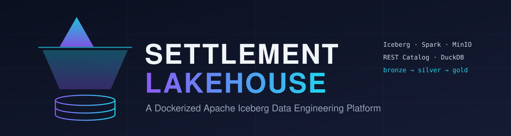
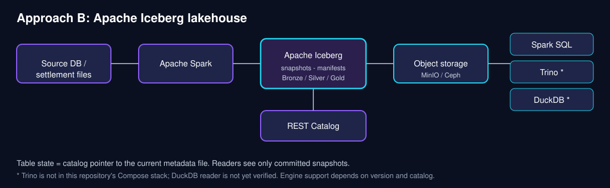
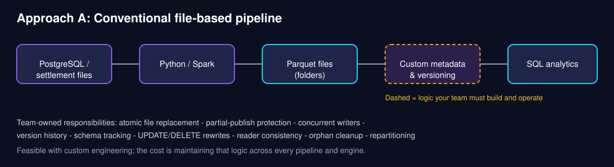
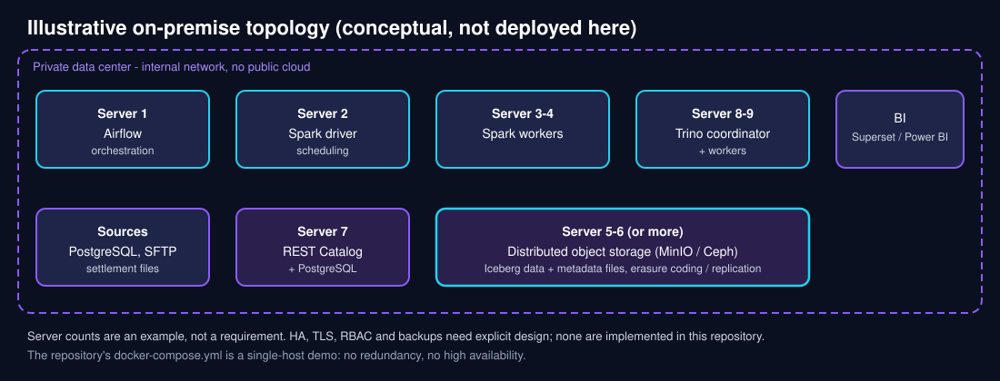

<p align="center"></p>

<p align="center">
  
  
  
  
  
</p>

# Settlement Lakehouse

**An enterprise-oriented, on-premise Apache Iceberg lakehouse for payment settlement and reconciliation.**

Synthetic multi-provider payment data → Spark → Apache Iceberg on MinIO (REST catalog) → Spark SQL / DuckDB. The goal is not a CSV-to-Parquet ETL: it is to show *why* an organization would manage settlement data as Iceberg tables, and what that costs.

> **Status (read first).** The full pipeline has been run successfully end to end (on a separate machine): Compose stack, Bronze ingestion, Silver transformation and quarantine, CDC `MERGE INTO`, reconciliation and Gold tables, quality checks, Iceberg feature demo and `demo` command. Also verified: synthetic generator, provider mapping, 18 Spark-free unit tests, the DuckDB reader and the integration tests (`pytest -m integration`). No Spark/Iceberg timings have been recorded. Trino and Airflow appear only in the documentation.

---

# Enterprise Case Study: AFFH IYH E-WALLET

> AFFH IYH E-WALLET is a **fictional** company and all data is **synthetic**.

## Business Context
A medium-to-large payment gateway running its own Linux servers in a private data center. It has an internal PostgreSQL transaction database, receives daily settlement files from several providers, and its Finance team needs daily reconciliation. Security and regulation keep transaction data out of public cloud.

## The Problem
Late-arriving corrections, inconsistent provider schemas, duplicate settlement files, records missing on either side, historical audit requirements, several tools reading the same data, growing volume and accumulating small files.

## Why a Traditional Pipeline Was Not Enough
A Parquet-file pipeline *can* handle all of this, but the team must build and maintain the logic itself: atomic file replacement, protection against partial publication, concurrency control, version history, schema tracking, UPDATE/DELETE rewrites, reader consistency across engines, cleanup and repartitioning. Details: [conventional_vs_iceberg.md](docs/conventional_vs_iceberg.md).

## Proposed Solution
Source systems → Apache Spark → Bronze / Silver / Gold → Apache Iceberg → MinIO (on-premise storage) → Spark / Trino / BI.



## Key Technical Decisions
| Decision | Reason |
|---|---|
| Apache Iceberg | Snapshot and table management |
| Apache Spark | Distributed transformation |
| MinIO | On-premise object storage |
| REST Catalog | Central table metadata access |
| Airflow *(design only)* | Workflow orchestration |
| Trino *(design only)* | Distributed SQL analytics |
| DuckDB | Lightweight analytical investigation |

Trade-offs and alternatives: [architecture_decisions.md](docs/architecture_decisions.md).

## Business Outcomes (expected, not measured)
More manageable history, controlled correction workflows, better auditability, consistent table access, less custom file-management logic, easier schema evolution, clearer maintenance routines. No performance or cost figures are claimed.

## Example Data Flow
1. Internal transactions arrive. 2. Provider settlement files are ingested. 3. Bronze stores source data. 4. Silver normalizes and deduplicates. 5. CDC applies corrections. 6. Gold produces reconciliation reports. 7. Finance queries via Trino or BI. *(Steps 1–6 have been run end to end; step 7 is a design target, the repo ships Spark SQL and DuckDB queries.)*

## What This Project Demonstrates
Data engineering and lakehouse architecture; distributed-processing tooling (Spark); CDC and SQL transformations; data quality design; metadata-driven provider mapping; on-premise storage and deployment design; governance concepts (auditability, access, retention). More scenarios: [enterprise_use_cases.md](docs/enterprise_use_cases.md); target deployment: [on_premise_deployment.md](docs/on_premise_deployment.md).

---

## Quick start (demo stack)

```bash
git clone https://github.com/pijar2000/settlement-iceberg-lakehouse.git
cd settlement-iceberg-lakehouse
cp .env.example .env            # PowerShell: Copy-Item .env.example .env
docker compose up -d --build    # first build compiles MinIO from source and is slow
docker compose run --rm pipeline python -m src.cli generate --rows 50000 --cdc-rows 5000
docker compose run --rm pipeline python -m src.cli demo --rows 50000 --cdc-rows 5000   # full pipeline
# or step by step: ingest, transform, cdc, reconcile, quality, iceberg-demo, analytics [--engine duckdb], inspect
```
Stop: `docker compose down`. `docker compose down -v` also **deletes all stored data**. Memory: lower `SPARK_DRIVER_MEMORY` in `.env`; the default 300,000-row dataset is the spec default, use `--rows` to shrink it.

| Service | URL (localhost only) |
|---|---|
| MinIO console / S3 | http://localhost:9001 / :9000 |
| Iceberg REST catalog | http://localhost:8181 |

The Compose file is a single-host demo: no redundancy or high availability.

## Architecture



## Feature matrix
| Capability | Status |
|---|---|
| 5 providers with differing schemas, duplicates, invalid rows, CDC I/U/D | tested (generator) |
| YAML-driven provider mapping | tested (unit tests, Python side) |
| MinIO + REST catalog in Compose | verified healthy |
| Bronze ingestion, Silver typing/dedup/quarantine | verified (full pipeline run) |
| CDC `MERGE INTO` (insert/update/delete) | verified (full pipeline run) |
| Reconciliation (5 classes, configurable) + Gold tables | verified (full pipeline run) |
| Data quality checks | verified (full pipeline run) |
| Time travel, rollback, schema/partition evolution, compaction, expiry (`iceberg-demo`) | verified (full pipeline run) |
| DuckDB reader (`analytics --engine duckdb`) | verified |
| Integration tests (`pytest -m integration`) | verified |
| Parquet vs Iceberg comparison | not implemented |

## Example output (actual, generator, seed 42)
```
internal_rows 300000 | internal_duplicates 4949 | internal_invalid 624
partner_rows 282241 | partner_duplicates 4641 | partner_invalid 539 | partner_orphans 1411
cdc_events: I=7998 U=9018 D=2984        (~20 s, ~71 MB CSV, host Python)
```
Illustrative query:
```sql
SELECT snapshot_id, committed_at, operation FROM bronze.internal_transactions.snapshots;
```

## Repository structure
`config/` provider + Spark settings · `docker/` minio, pipeline images · `scripts/generate_data.py` · `src/` cli, ingestion, transformations, cdc, reconciliation, quality, analytics, utilities · `sql/` silver/gold/analytics queries · `tests/` · `docs/` · `assets/`

## Documentation
[Architecture](docs/architecture.md) · [Conventional vs Iceberg](docs/conventional_vs_iceberg.md) · [Enterprise use cases](docs/enterprise_use_cases.md) · [On-premise deployment](docs/on_premise_deployment.md) · [Architecture decisions](docs/architecture_decisions.md) · [Data dictionary](docs/data_dictionary.md) · [Iceberg features](docs/iceberg_features.md) · [Reconciliation](docs/reconciliation.md) · [Performance](docs/performance.md) · [Contributing](CONTRIBUTING.md) · [Security](SECURITY.md)

## Limitations
Single host; Spark in local mode; REST *fixture* catalog (test-grade); demo credentials and a root-run catalog container; no TLS/RBAC; MinIO built from source because upstream images are no longer published.

## Roadmap
1. ~~Run the full pipeline end to end~~ (done). 2. Capture real output and replace the illustrative examples. 3. ~~Verify DuckDB access~~ (done). 4. ~~Run integration tests~~ (done); measure resources. 5. Parquet-vs-Iceberg comparison. 6. Optional Trino/Airflow profiles.

## Suggested GitHub settings
Description: *Production-style, Dockerized Apache Iceberg Lakehouse demonstrating CDC, Spark ETL, multi-provider payment reconciliation, snapshots, and data quality.*
Topics: `apache-iceberg` `data-engineering` `lakehouse` `apache-spark` `duckdb` `minio` `docker` `cdc` `data-platform` `payment-reconciliation`

## License
MIT — see [LICENSE](LICENSE).
