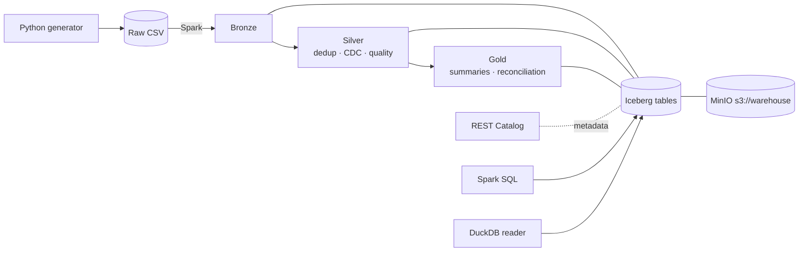

# Architecture

| Component | Image / library | Role | RAM limit |
|---|---|---|---|
| MinIO | built from source (`docker/minio`) | S3-compatible object store | 512 MB |
| REST Catalog | `apache/iceberg-rest-fixture:1.9.2` | Table registration (SQLite-backed, persisted in a volume) | 512 MB |
| Pipeline | custom image: Python 3.11, Java 17, PySpark 3.5.5, Iceberg 1.9.2 jars, DuckDB | Spark local-mode writer, CLI | 3 GB |

Spark runs in local mode inside the `pipeline` container, so there is no separate Spark service. `docker/spark/` is reserved for a future standalone cluster profile.

**Status:** MinIO and the REST catalog were verified healthy on Docker; the Spark/Iceberg pipeline stages have been run end to end successfully. MinIO is built from source (`docker/minio`).

DuckDB reading Iceberg tables via the REST catalog has been verified.
