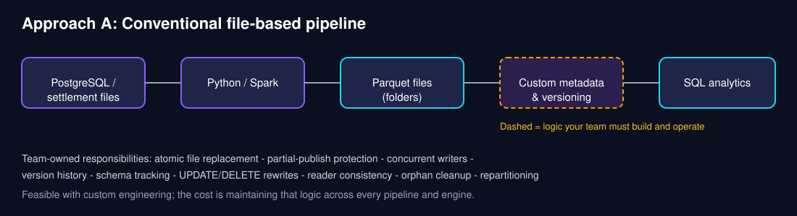
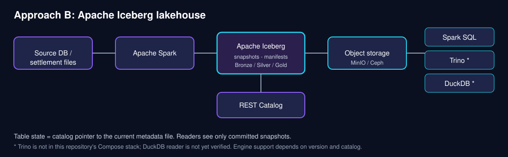

# Conventional Parquet Pipeline vs Apache Iceberg Lakehouse

Context: NEXORA PAYMENTS, a **fictional** payment gateway with synthetic data (see [enterprise_use_cases.md](enterprise_use_cases.md)).

Responsibilities are different and complementary: **Spark** processes data, **Parquet** is a columnar file format, **Iceberg** is an open *table format* that tracks which files make up a table and its history, **MinIO/Ceph** store the bytes, a **catalog** points to the current table state. Iceberg does not replace Spark or Parquet (Iceberg data files are typically Parquet), and it does not by itself make queries faster: performance still depends on partitioning, file sizes, statistics, the query engine and storage.

## Approach A: conventional pipeline

PostgreSQL / settlement files → Python or Spark → Parquet files → custom metadata and versioning → SQL analytics.

Nothing here is impossible. Each item below is something the team can build, but must then own and test:

| Concern | What the team has to implement |
|---|---|
| File replacement | Write to a temp location, swap folders or manifests atomically |
| Partial publication | Readers must never see half-written output (marker files, staging dirs) |
| Concurrent writes | Locking or a single-writer convention |
| Historical versions | Keep old folders, record which version a report used |
| Schema changes | Track schemas per file set; reconcile in readers |
| UPDATE / DELETE | Rewrite affected files, handle late corrections |
| Reader consistency | Several engines must agree on which files are current |
| Cleanup | Find and remove obsolete files safely |
| Partition changes | Rewrite or dual-path historical data |

## Approach B: Iceberg lakehouse

Settlement files / PostgreSQL → Spark → Iceberg → MinIO/Ceph, with a REST catalog; readers: Spark, Trino and other compatible engines.

## Comparison

| Capability | Parquet + custom logic | Iceberg (standard mechanism) |
|---|---|---|
| Atomic table commit | Custom | Snapshot commit via catalog |
| Time travel | Custom retention + lookup | Snapshots (limited by retention) |
| Rollback | Restore old folder/manifest | Rollback to a snapshot (engine/procedure support) |
| Schema evolution | Custom convention | Tracked in table metadata |
| Partition evolution | Usually a rewrite | Metadata change; old files keep old layout |
| Row-level changes | Custom rewrite jobs | `MERGE INTO` / `DELETE` where the engine supports it |
| Multi-engine access | Share paths and conventions | Share table through catalog (engine support varies) |
| File maintenance | Custom compaction/cleanup | Maintenance procedures (must still be scheduled) |
| Operational cost | Custom code to maintain | Catalog, metadata, maintenance jobs to operate |
| Query speed | Depends on layout | Depends on layout; **not automatically faster** |

## When Iceberg adds cost

A catalog dependency, snapshot/metadata growth, expiration and compaction jobs, and engine-version compatibility. See [architecture_decisions.md](architecture_decisions.md).

Status: this repository implements Approach B at demo scale. Approach A is documented, not implemented.
