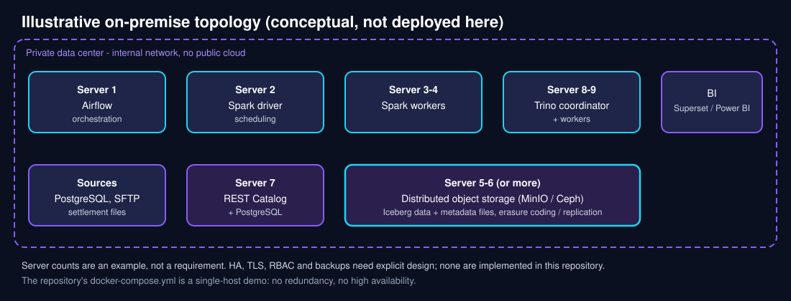

# On-Premise Deployment (conceptual)

> This document describes an enterprise target. The repository itself ships only a **single-host Docker Compose demo** (MinIO, Iceberg REST catalog fixture, Spark in a pipeline container). Nothing below beyond that has been built or tested here.

No public cloud service is required.

| Layer | Technology | In this repo |
|---|---|---|
| Source databases | PostgreSQL, Oracle, MySQL, SQL Server | synthetic CSV only |
| File ingestion | Internal SFTP | no |
| Processing | Apache Spark | yes (local mode) |
| Storage | MinIO, Ceph, or HDFS | MinIO (single node) |
| Table format | Apache Iceberg | yes |
| Catalog | Iceberg REST catalog or Hive Metastore | REST fixture |
| Catalog metadata DB | PostgreSQL where the implementation needs one | SQLite file (demo) |
| Orchestration | Apache Airflow | no |
| Query engine | Trino | no |
| BI | Superset or Power BI | no |
| Monitoring | Prometheus and Grafana (optional) | no |

## Keep these four things distinct
- **Catalog protocol**: the REST API clients speak.
- **Catalog implementation**: the service behind it (the demo uses the Iceberg REST fixture, which is for testing, not production).
- **Catalog metadata database**: where that service stores table pointers (SQLite here; PostgreSQL in a real deployment, if the implementation supports it).
- **Iceberg files**: data and metadata files, stored in object storage.

MinIO and Ceph both give on-premise S3-compatible storage; HDFS fits Hadoop-oriented estates. Not every catalog implementation supports every storage backend or topology, so check before choosing. Note that MinIO's community container images are no longer published, so this repo builds a pinned release from source (`docker/minio/Dockerfile`); review MinIO's current licensing and support terms before enterprise use.

## Illustrative multi-server topology
Server 1 Airflow; Server 2 Spark driver/scheduling; Servers 3-4 Spark workers; Servers 5-6 distributed object storage; Server 7 REST catalog + PostgreSQL; Servers 8-9 Trino coordinator and workers; all on an internal network. The counts are an example, not a requirement.

- **Scaling**: add Spark workers, Trino workers and storage nodes independently.
- **Redundancy / HA**: needs more than one node per critical role, including the catalog and its database (replication, failover). The example above has single points of failure (e.g. Server 7).
- **Durability**: depends on object-store erasure coding or replication and on separate backups.

## Security (all design guidance; **none implemented** in this repo)
Network isolation and firewalls; TLS between all services; authentication (SSO/LDAP/OIDC); role-based access control at catalog, engine and storage levels; secret management (Vault or equivalent, not `.env`); encryption at rest where the storage supports it; backups of the catalog database and object-store (they must be consistent with each other); disaster-recovery drills; audit logs.

**Demo defaults, not production**: credentials in `.env.example`, no TLS, catalog container runs as root to write its SQLite volume, ports bound to localhost.
